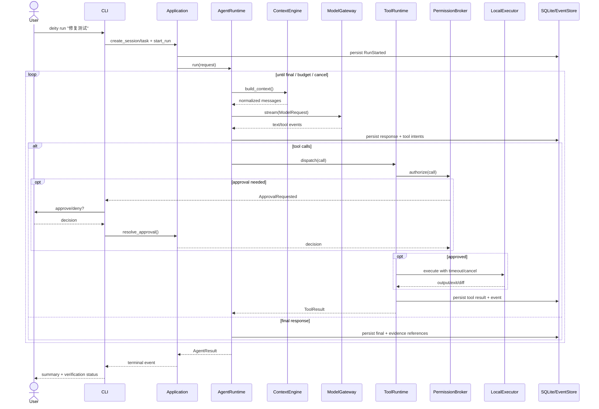

# Deity Harness 核心架构设计 V0.2

> 状态：**可实施的架构基线（Proposed）**；基于 V0.1 已确认的产品方向。日期：2026-10-31。本文中的 Python 代码为接口契约/伪实现，尚未经真实项目集成验证。架构变更通过 ADR 记录。

## 0. 设计目标与明确非目标

**目标**：让一个本地 CLI 驱动的 Python Coding Agent，跨模型协议安全地读取/搜索/修改工作区、运行命令、记录完整执行轨迹、给出可核验的结果；支持取消、预算、错误分类与基础会话持久化。

**V0.1 非目标**：FastAPI 服务、TUI、LangChain/LangGraph/Deep Agents Runtime、MCP、Skills 框架、Multi-Agent、Docker 沙箱、RAG、自动模型故障切换、分布式部署。**FastAPI 是未来的接口适配器**，不参与 Core 依赖。

**架构不变量**：① Core 不依赖 UI、SDK、SQLite；② 模型不直接执行工具；③ 工具执行一律经过 schema 校验、权限决策、边界检查、审计；④ 原始工具结果与验证证据不能由模型伪造；⑤ 已执行的副作用不得因重试模型请求而盲目重复；⑥ 每个 Run 在同一时刻仅有一个所有者；⑦ 取消优先于继续调用；⑧ 本地路径限制不是 OS 沙箱；⑨ 所有持久化状态变化必须与事件日志保持可追踪关系。

## 1. 分层、模块与依赖方向

```text
apps/cli (Typer + Rich; interactive/non-interactive)
   ↓
application (SessionService, RunService, ApprovalBroker, event subscription)
   ↓
core (AgentLoop, RunStateMachine, ContextBuilder, domain contracts)
   ├─ ModelProvider protocol  ← adapters/model/{openai_compatible,anthropic}
   ├─ ToolDispatcher protocol ← adapters/tools/{registry,permission,executors}
   ├─ SessionRepository       ← adapters/storage/sqlite
   └─ EventSink               ← adapters/storage/sqlite + CLI subscriber
                                     ↓
                             execution/local (filesystem, subprocess, git, rg)
```

| 边界 | 输入 | 输出 | 禁止事项 |
|---|---|---|---|
| CLI | args、用户输入、授权回答 | CLI 渲染、退出码 | 直接写库、直接调模型/执行 Shell |
| Application | session/run 请求 | Run handle、事件流、取消/审批 | 内嵌 Agent Loop |
| Core | 统一消息、端口协议、预算 | 状态迁移、工具请求、领域事件 | 导入 SDK/Typer/SQLite |
| Model adapters | ModelRequest | 规范化 ModelEvent | 文件/网络副作用工具调用 |
| Tool runtime | ToolCall + ExecutionContext | ToolResult | 跳过授权或边界校验 |
| Storage | 聚合/事件持久化 | 数据快照/事件序列 | 业务决策 |
| Execution | 已批准的操作 | exit/stdout/stderr/文件差异 | 自行授权 |

**目录落地**：`src/deity/{core,application,adapters,execution,interfaces}`；`tests/{unit,integration,e2e,fixtures}`；`evals/{cases,runners,reports}`。初期为单 Python package，不拆多个发布包。

## 2. 核心数据类型与端口（类型优先）

```python
from dataclasses import dataclass, field
from enum import StrEnum
from typing import AsyncIterator, Protocol, Literal, Any

class RunStatus(StrEnum):
    CREATED = 'created'
    RUNNING = 'running'
    WAITING_APPROVAL = 'waiting_approval'
    COMPLETED = 'completed'
    FAILED = 'failed'
    CANCELLED = 'cancelled'

@dataclass(frozen=True)
class AgentRequest:
    session_id: str
    task_id: str
    workspace: str
    user_text: str
    model: str
    max_turns: int = 30
    max_tool_calls: int = 100
    deadline_seconds: float = 900

@dataclass(frozen=True)
class AgentResult:
    run_id: str
    status: RunStatus
    final_text: str | None
    error_code: str | None
    evidence_ids: tuple[str, ...] = ()

@dataclass(frozen=True)
class ToolCall:
    call_id: str
    name: str
    arguments: dict[str, Any]

@dataclass(frozen=True)
class ToolResult:
    call_id: str
    status: Literal['ok','error','denied','timeout','cancelled']
    output: str
    exit_code: int | None = None
    truncated: bool = False
    evidence_id: str | None = None

class ModelProvider(Protocol):
    def capabilities(self) -> 'ModelCapabilities': ...
    def stream(self, request: 'ModelRequest') -> AsyncIterator['ModelEvent']: ...

class ToolDispatcher(Protocol):
    async def dispatch(self, call: ToolCall, ctx: 'ExecutionContext') -> ToolResult: ...

class SessionRepository(Protocol):
    async def create_run(self, request: AgentRequest) -> str: ...
    async def append_events(self, run_id: str, events: list['DomainEvent']) -> None: ...
    async def set_status(self, run_id: str, status: RunStatus) -> None: ...

class EventPublisher(Protocol):
    async def publish(self, event: 'DomainEvent') -> None: ...
```

**设计约束**：上述示例是语义契约，不要求将所有 DTO 放在一个文件。边界 DTO 使用 `dataclass` 或 Pydantic（API 校验层），内部模型避免不必要的序列化。`ModelProvider.stream` 是异步生成器，取消需关闭底层 SDK stream。所有对象携带稳定 ID；`run_id` 由应用层生成并落库。时间使用 UTC ISO8601，数据库采用整数毫秒或标准化 UTC 文本，保持一致。

## 3. Agent Loop 与状态机

### 3.1 状态迁移

| 当前 | 事件 | 下一状态 | 条件/动作 |
|---|---|---|---|
| CREATED | start | RUNNING | 初始化 run、写 RunStarted |
| RUNNING | approval_required | WAITING_APPROVAL | 写 ToolApprovalRequested；释放执行权但保留 run owner |
| WAITING_APPROVAL | approve/deny | RUNNING | 写 ApprovalResolved；拒绝作为 tool result 反馈模型 |
| RUNNING / WAITING_APPROVAL | cancel | CANCELLED | 传播取消、停止子进程、落库 |
| RUNNING | final_answer | COMPLETED | 无未处理工具调用；汇总实际验证证据 |
| RUNNING | fatal_error/budget_exceeded | FAILED | 分类记录失败 |
| RUNNING | recoverable_error | RUNNING | 有界重试/将工具错误反馈模型 |

V0.1 **不提供 PAUSED/RESUMED**：避免虚假的任意位置恢复承诺。异常进程退出后，未完成 Run 标记 `interrupted`（存储层恢复标记），用户可在新 Run 中继续会话；不自动重放有副作用工具。后续引入真正 checkpoint 再扩展状态机。

### 3.2 循环算法（核心伪代码）

```python
async def run_agent(req, provider, dispatcher, context, repo, emit, cancel):
    run_id = await repo.create_run(req)
    await transition(run_id, 'created', 'running', emit, repo)
    turns = tool_count = 0
    try:
        while turns < req.max_turns:
            cancel.raise_if_cancelled()
            check_deadline_and_budget(req)
            messages = await context.build(req.session_id, run_id)
            turns += 1
            # 聚合流式 delta；仅在 tool call 参数完整后才执行
            response = await collect_model_stream(provider.stream(make_request(req, messages)), emit)
            if response.tool_calls:
                for call in response.tool_calls:  # V0.1 串行执行以减少副作用冲突
                    cancel.raise_if_cancelled()
                    if tool_count >= req.max_tool_calls:
                        raise BudgetExceeded('max_tool_calls')
                    tool_count += 1
                    result = await dispatcher.dispatch(call, execution_context(req, run_id, cancel))
                    await persist_tool_result_and_append_context(run_id, call, result)
                continue
            if response.final_text is not None:
                return await finish_with_evidence(run_id, response.final_text)
            raise ProtocolError('empty model response')
        raise BudgetExceeded('max_turns')
    except UserCancelled:
        await finalize(run_id, 'cancelled')
    except Exception as exc:
        await finalize(run_id, 'failed', classify(exc))
```

**必须实现的细节**：① 一次模型响应中可以有多个工具调用；顺序执行并按原 `call_id` 返回；② 不在未完成 JSON 参数上执行工具；③ 模型仅返回文本时可以结束，但最终报告注明未验证事项；④ 模型请求失败只能在尚未执行本轮工具前进行有界重试；⑤ 最大轮次、工具次数、墙钟时间均可配置；⑥ `Ctrl+C` 触发取消而不是仅退出 CLI；⑦ 所有终止路径释放资源、写终态、输出明确退出码。

## 4. 模型统一协议与流式事件

### 4.1 请求契约

```python
@dataclass(frozen=True)
class ModelCapabilities:
    tool_calling: bool
    streaming: bool
    parallel_tool_calls: bool
    max_context_tokens: int | None
    max_output_tokens: int | None
    usage_reporting: bool

@dataclass(frozen=True)
class ModelRequest:
    model: str
    messages: tuple['Message', ...]  # system/user/assistant/tool，保留 tool_call_id
    tools: tuple['ToolDefinition', ...]
    max_output_tokens: int | None = None
    temperature: float | None = None
```

### 4.2 事件类型（判别联合）

| 事件 | 字段 | 语义 |
|---|---|---|
| `message_started` | message_id | 响应开始 |
| `text_delta` | text | UI 可直接增量渲染 |
| `tool_call_started` | call_id, name | 工具请求开始（不执行） |
| `tool_call_arguments_delta` | call_id, fragment | JSON 片段（不执行） |
| `tool_call_completed` | call_id, name, arguments | 解析/校验后的完整请求 |
| `usage` | input_tokens, output_tokens, cache_tokens? | 统计信息，可缺失 |
| `message_completed` | finish_reason | 响应结束；标记 final/tool_calls/length |
| `model_error` | code, retryable, message | 规范化失败 |

**顺序不变量**：每个 `call_id` 只完成一次；必须在 `message_completed` 后提交整批工具调用；`finish_reason=length` 时不得把残缺参数当完整请求；缺失 usage 标记为 unknown，不能填 0 冒充实测。模型推理内容若供应商提供，默认不持久化敏感原始推理；只保留合规可用的元数据。

**适配策略**：`OpenAICompatibleAdapter` 与 `AnthropicAdapter` 各自映射 SDK 流事件；能力不支持时显式失败或禁用特性；不宣称无损互通。首版配置显式选择 provider/model，不做自动降级。

## 5. 工具协议、权限与执行边界

### 5.1 工具定义

```python
@dataclass(frozen=True)
class ToolDefinition:
    name: str
    description: str
    json_schema: dict
    risk: Literal['read','workspace_write','execute','high_risk']

@dataclass(frozen=True)
class ExecutionContext:
    run_id: str
    workspace_root: str
    deadline_seconds: float
    # 真实实现额外包含 cancel token、policy、事件/证据写入端口
```

V0.1 内建：`read_file`, `list_files`, `grep`, `glob`, `apply_patch`, `write_file`, `shell`, `git_status`, `git_diff`。所有参数以 JSON Schema/Pydantic 校验；未知工具返回结构化 `unknown_tool`；超长输出截断并记录 `truncated=true`，不得静默截断。

后续增加 `delete_file` 单文件工具：模型根据会话历史解析当前用户的目标；工具禁止目录、symlink、`.git` 与越界路径，不通过放开 `rm` 实现。见 [ADR-009](adr-009-model-resolved-file-deletion.md)。

### 5.2 执行管线

```text
normalized tool_call
 → resolve registry → validate schema → classify risk
 → workspace path canonicalization + symlink/reparse-point checks
 → permission decision (allow/deny/ask)
 → approval broker (if ask)
 → execute with cancellation + timeout + output cap
 → persist ToolResult + audit event → append model-visible tool result
```

**默认策略**：只读工作区内文件允许；工作区内写操作可配置为逐次确认或 session 授权；Shell 默认需要审批（可通过受控 allowlist 缩小审批范围）；工作区外写、越界删除、危险系统命令默认拒绝。拒绝不是异常崩溃，而是可反馈模型的 `denied` 工具结果。模型输出、仓库文件、工具 stdout 都视为不可信输入，不能通过提示词改变权限。

**Shell 约束**：使用 `asyncio.create_subprocess_exec` 或受控 shell 调用；明确 cwd、env 白名单、超时、stdout/stderr 大小上限；取消时先终止进程组，宽限后强杀；不保证所有孙进程均可清理。路径校验不足以构成真正沙箱；Docker/OS 隔离属于后续阶段。密钥和令牌不写日志、不暴露给模型。

**补丁约束**：`apply_patch` 基于文件当前内容或 hash 校验，冲突时失败并让模型重新读取；写入尽量采用临时文件+原子替换；不自动执行 `git reset --hard`、`git clean -fd`；用户未提交改动必须保留。

## 6. Session / Task / Run / Step 数据模型

**关系**：Session(1)→Task(N)→Run(N)→Step(N)；一个 Session 绑定一个工作区，Task 表示用户目标，Run 是一次执行尝试，Step 是一次模型轮次或工具执行。V0.1 不做自动重放；同一 session 不并发运行多个会修改同一工作区的 Run。

### 6.1 SQLite 初版 Schema（示意，可作为首个迁移）

```sql
PRAGMA foreign_keys = ON;
CREATE TABLE schema_migrations(version INTEGER PRIMARY KEY, applied_at TEXT NOT NULL);
CREATE TABLE sessions (
  id TEXT PRIMARY KEY, workspace_root TEXT NOT NULL, created_at TEXT NOT NULL,
  updated_at TEXT NOT NULL, title TEXT
);
CREATE TABLE tasks (
  id TEXT PRIMARY KEY, session_id TEXT NOT NULL REFERENCES sessions(id),
  prompt TEXT NOT NULL, created_at TEXT NOT NULL
);
CREATE TABLE runs (
  id TEXT PRIMARY KEY, task_id TEXT NOT NULL REFERENCES tasks(id),
  status TEXT NOT NULL, model_provider TEXT NOT NULL, model_name TEXT NOT NULL,
  started_at TEXT, ended_at TEXT, error_code TEXT,
  max_turns INTEGER NOT NULL, max_tool_calls INTEGER NOT NULL
);
CREATE TABLE steps (
  id TEXT PRIMARY KEY, run_id TEXT NOT NULL REFERENCES runs(id),
  ordinal INTEGER NOT NULL, kind TEXT NOT NULL, status TEXT NOT NULL,
  started_at TEXT NOT NULL, ended_at TEXT,
  UNIQUE(run_id, ordinal)
);
CREATE TABLE events (
  id TEXT PRIMARY KEY, run_id TEXT NOT NULL REFERENCES runs(id),
  sequence INTEGER NOT NULL, type TEXT NOT NULL, payload_json TEXT NOT NULL,
  created_at TEXT NOT NULL, UNIQUE(run_id, sequence)
);
CREATE TABLE messages (
  id TEXT PRIMARY KEY, session_id TEXT NOT NULL REFERENCES sessions(id),
  run_id TEXT REFERENCES runs(id), role TEXT NOT NULL,
  content_json TEXT NOT NULL, ordinal INTEGER NOT NULL
);
CREATE TABLE tool_executions (
  id TEXT PRIMARY KEY, run_id TEXT NOT NULL REFERENCES runs(id),
  call_id TEXT NOT NULL, tool_name TEXT NOT NULL, args_json TEXT NOT NULL,
  status TEXT NOT NULL, result_json TEXT, approval TEXT,
  UNIQUE(run_id, call_id)
);
CREATE TABLE evidence (
  id TEXT PRIMARY KEY, run_id TEXT NOT NULL REFERENCES runs(id),
  kind TEXT NOT NULL, source_tool_call_id TEXT, summary TEXT NOT NULL,
  payload_json TEXT NOT NULL, created_at TEXT NOT NULL
);
CREATE INDEX idx_events_run_seq ON events(run_id, sequence);
CREATE INDEX idx_messages_session_ord ON messages(session_id, ordinal);
```

**一致性**：每次工具结果和对应事件在同一 SQLite transaction 提交；事件发布给 CLI 在持久化成功之后进行；SQLite WAL、busy timeout、事务内分配每个 Run 的连续 sequence。JSON payload 有 `schema_version`，敏感字段脱敏，超大 stdout 只存摘要/受控 artifact 路径。启动时检测 RUNNING/WAITING_APPROVAL 的遗留 Run 并标记为 `interrupted`（存储终态枚举需支持），不擅自继续执行。

## 7. 事件总线与完整执行时序

### 7.1 领域事件

`RunStarted`, `ModelRequestStarted`, `ModelTextDelta`, `ModelResponseCompleted`, `ToolCallRequested`, `ApprovalRequested`, `ApprovalResolved`, `ToolStarted`, `ToolCompleted`, `VerificationRecorded`, `RunCompleted`, `RunFailed`, `RunCancelled`。

流式 `ModelTextDelta` 可以仅实时转发并批量落库，避免每 token 写 SQLite；关键状态、工具调用和终态必须持久化。事件携带 `event_id`, `run_id`, `sequence`, `timestamp`, `type`, `payload_version`。UI 只订阅事件，不反向影响核心状态（审批通过明确的 Application API）。

### 7.2 正常任务时序



### 7.3 失败、取消、审批超时

- **模型 429/5xx**：仅在本轮尚无工具副作用时指数退避重试（有限次数 + jitter）；401/403、参数错误直接失败。
- **工具执行失败**：转为 `ToolResult(status=error)` 并让模型修复；超时/取消按专用状态处理。
- **审批超时/无交互模式**：`ask` 模式默认拒绝；显式配置的 `auto` 模式只自动执行工作区内写入与受限 Shell 命令，见 [ADR-008](adr-008-auto-tool-authorization.md)。
- **Ctrl+C**：CLI 调用 `RunService.cancel(run_id)` → cancellation token → 关闭模型 stream/终止 subprocess → 持久化 `RunCancelled`；第二次 Ctrl+C 可以强制退出，但记录恢复限制。
- **模型响应不完整**：不执行部分工具调用，返回协议错误。
- **进程崩溃**：遗留运行标记 interrupted；恢复仅提供历史上下文，不自动重复外部操作。

## 8. Context Engine 与项目指令

上下文顺序：Harness system rules → 仓库 `AGENTS.md`（可信度低于系统策略）→ 当前用户任务 → 会话摘要/历史 → 最近工具结果。仓库说明以低优先级任务上下文传递，不放入 system 消息；当前用户明确要求在工作区写文件时，不得仅因项目说明中的范围描述拒绝。只读取当前工作区内允许的 AGENTS.md，遵循固定的查找优先级；限制文件大小、编码和 token 占用；不得将仓库指令视为授权来源。V0.1 实现估算 token 预算、最近消息保留、超大工具结果截断；**不实现未经验证的自动 compaction**。预留 `ContextPolicy` 接口以便 V0.2+ 加入摘要压缩。

## 9. 错误模型、预算与安全边界

| 类别 | 典型代码 | 重试策略 |
|---|---|---|
| Model | `model_rate_limited`, `model_timeout`, `model_auth` | 前两者有界重试；认证不重试 |
| Protocol | `invalid_tool_arguments`, `incomplete_stream` | 返回模型修正或失败 |
| Tool | `tool_failed`, `tool_timeout`, `unknown_tool` | 默认作为结果反馈；不盲目重放 |
| Permission | `permission_denied`, `approval_timeout` | 默认拒绝 |
| Context | `context_overflow` | 裁剪/明确失败 |
| Runtime | `budget_exceeded`, `cancelled`, `internal_error` | 终止并审计 |

预算：`max_turns`、`max_tool_calls`、每次模型调用 timeout、每次工具 timeout、总墙钟 deadline、输出字节上限；最后一个允许的模型轮次不再提供工具，要求模型基于已有证据给出最终结论，避免工具探索直接耗尽轮次。若 provider 返回 usage，记录 token/cost（成本依赖用户配置价目表，不伪造）；若无法准确统计，则记录 unknown。

## 10. 工程结构、技术栈与测试门禁

```text
deity/
├── AGENTS.md
├── README.md
├── pyproject.toml                 # 实现阶段新增
├── src/deity/
│   ├── __init__.py
│   ├── interfaces/cli/
│   ├── application/
│   ├── core/{runtime,contracts,context,events,state}/
│   ├── adapters/{model,tools,storage}/
│   └── execution/local/
├── tests/{unit,integration,e2e,fixtures}/
├── evals/{cases,runners,reports}/
└── docs/{01-project,02-architecture,03-development,04-evaluation}/
```

Python 3.12+、`uv`、Typer/Rich、Pydantic、官方模型 SDK、`aiosqlite` 或 `sqlite3` 的受控异步适配、`pytest`/`pytest-asyncio`、`ruff`、`mypy`、ripgrep、Git CLI。不要在 Core 中引入 FastAPI。代码质量门禁：lint + typecheck + unit + integration；有副作用的端到端评估只在隔离 fixture 仓库中运行。

## 11. 交付顺序（可独立验收）

| 里程碑 | 交付 | 验收 |
|---|---|---|
| M0 | package、CLI skeleton、配置、测试门禁 | `deity --help`、CI 通过 |
| M1 | contracts、FakeModel、FakeTools、AgentLoop | 无网络端到端假模型用例 |
| M2 | 两个模型适配器 + stream parser | text/tool call/错误协议契约测试 |
| M3 | 文件/rg/patch/shell + 权限 | 只读成功、越界拒绝、审批、取消 |
| M4 | SQLite + 事件 + 会话 | 重启后历史可查、无副作用重放 |
| M5 | 固定评估任务 + 报告 | 见 `evaluation-plan.md` 的阻断门禁 |

## 12. 未决项与 ADR 触发器

- M4 初版采用 `aiosqlite` 与单连接写锁；依据与代价见 [ADR-006](adr-006-aiosqlite-v0.1.md)。多进程写入性能与所有权策略留待后续版本重新评估。
- 工具审批默认值、跨平台进程组处理、token 估算实现：用 ADR 记录具体方案。
- V0.1 不承诺任意位置恢复；真正 checkpoint、自动 compaction、MCP、Docker 在后续版本设计。
- V0.3 的安全边界恢复与 Checkpoint 决策见 [ADR-007](adr-007-v0.3-reliable-resume.md)；不改变本版 `interrupted` 终态语义。
- 任何跨模块依赖反转、事件协议破坏性变更、工具风险策略变化必须记录 ADR 和迁移方案。

## 13. 评审清单

- [ ] CLI 可替换，Runtime 无 UI 依赖
- [ ] 模型协议有完整 tool-call 流聚合与终止语义
- [ ] 工具均有 schema、权限、超时、取消、审计
- [ ] 同一 Run 无重复执行相同 `call_id`
- [ ] 状态迁移可测试，终态只能写入一次
- [ ] SQLite 事件顺序、事务一致性与敏感信息脱敏已测试
- [ ] 取消能终止受控子进程，不把路径校验宣传为沙箱
- [ ] 最终报告区分 PASS/FAIL/NOT_RUN/UNKNOWN
- [ ] 不以模型自评替代评估断言

**关联文档**：`../01-project/deity-v0.1-plan.md`、`../03-development/development-guide.md`、`../04-evaluation/evaluation-plan.md`、`../../AGENTS.md`。
