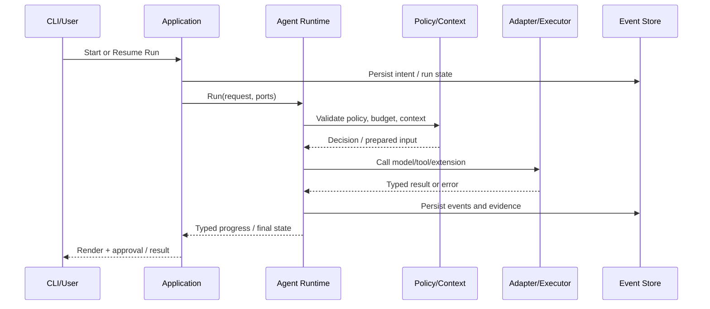

# Deity V0.3 — Reliable Agent Runtime 详细设计

> 状态：Proposed；依赖 V0.1/V0.2 基线；不是已实现或已通过验证的功能。

实施协议、阶段门禁与故障注入矩阵见 [V0.3 Reliable Runtime 实施文档](../03-development/v0.3-reliable-runtime-implementation.md)；恢复边界决策见 [ADR-007](../02-architecture/adr-007-v0.3-reliable-resume.md)。本设计中的接口与阈值由实施文档细化，未编码前均为目标。

## 1. 版本目标与范围

**目标：**让长任务在上下文压力、进程中断、网络失败、取消及副作用不确定时仍可控。

**范围控制：**仅引入实现本版本验收所需的依赖和新接口。任何跨层改动必须有 ADR；现有 CLI、FakeModel、基础工具及 SQLite 回归测试必须继续通过。

## 2. 模块与接口设计

### 2.1 上下文预算与压缩

**实现机制与执行流程**：ContextBudget {model_window,reserved_output,system,tools,safety_margin}; `estimate_tokens` 可插拔；压缩触发采用 75% 软阈值、90% 硬阈值作为初始配置；先裁剪/外置大工具输出，再结构化摘要；摘要必须保留任务目标、用户约束、已修改文件、未解决问题、验证证据引用、待办与审批状态；摘要校验失败不得覆盖原始上下文。

**接口/数据契约与交付物**：ContextPolicy、Compactor、ContextSnapshot、ArtifactRef；`ContextCompacted` 事件记录原始消息范围、摘要 hash、token 前后估计。

**必须覆盖的失败与边界场景**：超长工具输出、上下文窗口缩小、摘要失败、连续压缩两次、敏感信息混入摘要。

**建议实现步骤**：

1. 在 `core/contracts` 定义与具体 SDK 无关的数据类型、错误码、状态及事件 schema。
2. 在 `core`/`application` 实现策略与协调逻辑，适配器负责外部 I/O。
3. 增加 Fake 适配器的确定性单测，覆盖成功、拒绝、异常、取消、重复调用。
4. 接入真实后端并写集成 fixture；在 CLI 提供最小可用入口。
5. 输出审计事件、验证证据、基准结果和回退说明。

### 2.2 持久化与恢复

**实现机制与执行流程**：SQLite WAL + 单 writer 事务；runs/steps/events/tool_executions/checkpoints 增加 schema_version；执行前写 intent，执行后写 outcome；重启扫描 running/awaiting 状态，置 interrupted 并进行 reconcile；不可确认副作用要求人工确认，不自动重试。

**接口/数据契约与交付物**：RunLease(run_id,owner,epoch,expires_at)、Checkpoint(version,context_ref,last_event_seq)、RecoveryDecision(resume|manual_review|abort)。

**必须覆盖的失败与边界场景**：进程在工具成功后但写结果前崩溃、重复启动、事件序号冲突、DB busy、磁盘满。

**建议实现步骤**：

1. 在 `core/contracts` 定义与具体 SDK 无关的数据类型、错误码、状态及事件 schema。
2. 在 `core`/`application` 实现策略与协调逻辑，适配器负责外部 I/O。
3. 增加 Fake 适配器的确定性单测，覆盖成功、拒绝、异常、取消、重复调用。
4. 接入真实后端并写集成 fixture；在 CLI 提供最小可用入口。
5. 输出审计事件、验证证据、基准结果和回退说明。

### 2.3 取消、重试与预算

**实现机制与执行流程**：asyncio.TaskGroup/取消 token；模型请求退避带抖动且受预算约束；区分 retryable/network/rate-limit/invalid-schema；shell 进程组终止 SIGTERM→grace→SIGKILL，Windows 用受控进程树清理；终态不复活；总耗时、tokens、工具次数、费用估算四种预算。

**接口/数据契约与交付物**：CancellationScope、RetryPolicy、RunBudget、ErrorCode；CLI `deity run --max-steps --timeout`、`deity resume`。

**必须覆盖的失败与边界场景**：Ctrl+C、流式响应半包、超时竞争、取消后仍有工具事件、重复副作用。

**建议实现步骤**：

1. 在 `core/contracts` 定义与具体 SDK 无关的数据类型、错误码、状态及事件 schema。
2. 在 `core`/`application` 实现策略与协调逻辑，适配器负责外部 I/O。
3. 增加 Fake 适配器的确定性单测，覆盖成功、拒绝、异常、取消、重复调用。
4. 接入真实后端并写集成 fixture；在 CLI 提供最小可用入口。
5. 输出审计事件、验证证据、基准结果和回退说明。

### 2.4 可观测与基线

**实现机制与执行流程**：事件序列、trace_id/run_id/step_id/tool_call_id 贯通；对敏感参数和 stdout 做脱敏/截断；基础 metrics 记录每轮耗时、模型失败、工具失败、恢复成功率；CLI `deity runs inspect`。

**接口/数据契约与交付物**：TraceEvent schema v1、metrics JSONL 导出。

**必须覆盖的失败与边界场景**：泄漏 API key、日志洪泛、事件丢失、事件与终态不一致。

**建议实现步骤**：

1. 在 `core/contracts` 定义与具体 SDK 无关的数据类型、错误码、状态及事件 schema。
2. 在 `core`/`application` 实现策略与协调逻辑，适配器负责外部 I/O。
3. 增加 Fake 适配器的确定性单测，覆盖成功、拒绝、异常、取消、重复调用。
4. 接入真实后端并写集成 fixture；在 CLI 提供最小可用入口。
5. 输出审计事件、验证证据、基准结果和回退说明。

## 3. 执行时序（实现基线）

**故障规则**：外部副作用执行前记录 intent；结果未知时保留 `unknown` 并要求协调，不得因网络或进程重启而盲目重放。取消、超时、审批拒绝均产生可追踪终态或等待态。

## 4. 开发拆分与顺序

| 迭代 | 工作项 | 产出 | 依赖 |
|---|---|---|---|
| S0 | 固定 V0.2 回归、旧数据库 fixture 与协议 | 基线报告、ADR | V0.2 ports |
| S1 | 先持久化完整模型响应、工具 intent/outcome 与可见消息 | 迁移、事务与崩溃测试 | S0 |
| S2 | 上下文预算、确定性压缩与 Checkpoint | 策略、快照与校验测试 | S1 |
| S3 | 租约、恢复判定与 CLI `resume/inspect` | 安全边界继续与人工核对 | S2 |
| S4 | 重试、取消、预算与事件观测 | 全链路取消和错误矩阵 | S3 |
| S5 | 长任务故障注入和指标基线 | R01–R06 报告与回归门禁 | S4 |

先完成 S1，是因为 V0.1 的工具结果仅保存状态元数据，无法重建完整模型可见上下文；各阶段文件与测试门禁以实施文档第 7–8 节为准。

## 5. 验收标准（可执行）

- [ ] 单次长任务模拟 ≥100 步不超过配置预算，压缩后保留固定约束断言
- [ ] 故障注入覆盖 5 个断点且无自动重放未知副作用
- [ ] Ctrl+C 后进程及子进程按平台策略收敛，终态一致
- [ ] 相同 fixture 在两种模型适配器与 FakeModel 下通过核心协议测试

上述目标由实施文档 R01–R06 及 V0.1 E01–E08 的机器断言验收；未运行前保持未勾选。

## 6. 指标与观测

记录 `run_id`、`step_id`、`event_seq`、版本、模型、配置哈希、耗时、工具调用、失败类别、预算、真实验证证据。默认比较基线：V0.1/V0.2 既有 fixture；新能力不得使安全测试回退。阈值需在真实基线测量后固化到 CI。

## 7. 回退与兼容

新能力默认受配置开关控制；关闭后旧流程仍可运行。数据库变更必须提供 forward migration 与可执行的备份/恢复流程；事件 schema 版本化，旧事件只读兼容。发生严重权限或重复副作用缺陷时立即禁用相关功能并阻断发布。

## 8. 明确不做

不引入 LangChain/LangGraph/Deep Agents Runtime；不提前实现后续版本的 UI/分布式组件；不使用模型自评替代测试；不把本地工作区约束描述为沙箱。

## 统一工程约束（所有版本强制执行）

1. **边界不变**：`interfaces → application → core ports ← adapters`；Core 不依赖 CLI、FastAPI、厂商 SDK、SQLite、MCP SDK、Docker SDK。新功能通过 Protocol 注入；禁止跨层快捷调用。
2. **最小依赖**：只在功能实现的那个版本引入实际需要的依赖。新依赖必须记录用途、许可证、维护状态、替代方案、版本锁定、移除成本和安全风险；优先复用 Python 标准库与已存在组件。严禁为了未来可能的功能提前安装完整技术栈。
3. **安全前置**：任何新工具/协议/执行环境必须复用 `schema → policy → boundary → approval → execute → audit`；不把提示词、Skill、AGENTS.md 或 MCP 返回值当作授权依据。Shell 的工作目录限制不是隔离。
4. **验证前置**：每个功能同步交付确定性单元测试、故障注入、集成测试、评估 fixture、事件证据。不能把基准测试、取消、权限、事件审计拖到 V0.9 才做；V0.9 只是平台化。
5. **演进纪律**：数据库/事件/配置格式必须标注版本，提供迁移或向后兼容策略；破坏性修改先写 ADR。所有阶段都有开关和可回退方案。
6. **状态真实性**：模型的文字不能替代工具执行证据。恢复时对结果未知的副作用标记 `unknown`，不得自动重放。
7. **质量门禁**：`ruff check .`、`ruff format --check .`、`mypy src`、`pytest`，以及该版本新增的集成/安全/评估门禁；如未运行，报告必须明确标记。

## 版本交付模板

每一版本必须提供：设计 ADR、接口与数据模型变更、可运行演示、正常/失败/取消测试、指标报告、回滚操作、文档更新。指标阈值是**建议的初始验收目标**，应在首轮基线测量后经 ADR 校准，不得伪称已经达标。
