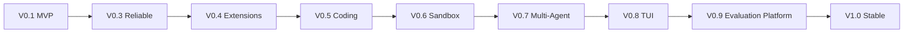

# Deity V0.3–V1.0 深度技术路线与实施设计

> 文档状态：**规划与设计提案，非已实现功能**。基线：Deity V0.1 MVP + V0.2 核心架构。核心 Python 3.12+，本地 CLI 优先，FastAPI 仅未来可选入口；不使用 LangChain、LangGraph、Deep Agents Runtime，自研 Agent Loop、状态机、Context Engine、Tool Runtime。参考 Deep Agents/OpenCode 等思想，不复制其实现。

## 总体策略与依赖顺序

**可靠性 → 可扩展性 → Coding 深度 → 沙箱 → 多 Agent → TUI → 系统化评估 → 稳定发布。** 这是建议交付顺序，不意味着安全、验证、日志要延后：V0.1 就必须有最小权限、取消、审计与 fixture；每版持续加强。V0.2 是架构基线而非另一个运行时版本。

| 版本 | 关键交付 | 主要新增依赖（仅实际需要时） | 必须满足的前置条件 |
|---|---|---|---|
| V0.3 | 压缩、恢复、预算、取消 | 优先 stdlib/SQLite | V0.1 基础事件与 Run 状态可靠 |
| V0.4 | MCP/Skills/Hooks | MCP Python SDK（可选 extra） | 统一 Tool Runtime 权限链 |
| V0.5 | Plan/Build、代码智能、验证 | 可选 tree-sitter/LSP | 稳定工具/证据协议 |
| V0.6 | Docker 隔离 | Docker SDK 或 CLI adapter | 执行后端 Protocol 与安全策略 |
| V0.7 | Sub-Agent | 优先 asyncio | 独立 Run、预算、取消、上下文隔离 |
| V0.8 | TUI | Textual（可选 extra） | 事件订阅与审批 API 稳定 |
| V0.9 | Benchmark 平台 | pytest + 统计库按需 | 固定 fixture 与事件证据积累 |
| V1.0 | 稳定发布 | 构建/扫描工具按需 | 兼容、安全、发布门禁 |

### 跨版本依赖与升级门禁

原则上按顺序发布；如果某项技术需求提前出现，可以按 ADR 调整交付时间，但不得绕过安全与测试门禁。每版完成后：冻结接口快照→运行全量回归→记录测量结果→更新文档→打版本 tag。

## 统一工程约束（所有版本强制执行）

1. **边界不变**：`interfaces → application → core ports ← adapters`；Core 不依赖 CLI、FastAPI、厂商 SDK、SQLite、MCP SDK、Docker SDK。新功能通过 Protocol 注入；禁止跨层快捷调用。
2. **最小依赖**：只在功能实现的那个版本引入实际需要的依赖。新依赖必须记录用途、许可证、维护状态、替代方案、版本锁定、移除成本和安全风险；优先复用 Python 标准库与已存在组件。严禁为了未来可能的功能提前安装完整技术栈。
3. **安全前置**：任何新工具/协议/执行环境必须复用 `schema → policy → boundary → approval → execute → audit`；不把提示词、Skill、AGENTS.md 或 MCP 返回值当作授权依据。Shell 的工作目录限制不是隔离。
4. **验证前置**：每个功能同步交付确定性单元测试、故障注入、集成测试、评估 fixture、事件证据。不能把基准测试、取消、权限、事件审计拖到 V0.9 才做；V0.9 只是平台化。
5. **演进纪律**：数据库/事件/配置格式必须标注版本，提供迁移或向后兼容策略；破坏性修改先写 ADR。所有阶段都有开关和可回退方案。
6. **状态真实性**：模型的文字不能替代工具执行证据。恢复时对结果未知的副作用标记 `unknown`，不得自动重放。
7. **质量门禁**：`ruff check .`、`ruff format --check .`、`mypy src`、`pytest`，以及该版本新增的集成/安全/评估门禁；如未运行，报告必须明确标记。

## 版本交付模板

每一版本必须提供：设计 ADR、接口与数据模型变更、可运行演示、正常/失败/取消测试、指标报告、回滚操作、文档更新。指标阈值是**建议的初始验收目标**，应在首轮基线测量后经 ADR 校准，不得伪称已经达标。

## 各版本详细设计入口

- [V0.3：Reliable Agent Runtime](./deity-v0.3-design.md)
- [V0.4：Extensible Harness](./deity-v0.4-design.md)
- [V0.5：Advanced Coding Agent](./deity-v0.5-design.md)
- [V0.6：Execution Sandbox](./deity-v0.6-design.md)
- [V0.7：Multi-Agent Runtime](./deity-v0.7-design.md)
- [V0.8：Developer Experience / TUI](./deity-v0.8-design.md)
- [V0.9：Evaluation & Experimentation Platform](./deity-v0.9-design.md)
- [V1.0：Stable Release](./deity-v1.0-design.md)

## 外部参考与使用边界

- Deep Agents 架构：https://github.com/langchain-ai/deepagents/blob/main/libs/ARCHITECTURE.md （借鉴 middleware、backends、profiles 的职责分离，但不使用其 LangGraph Runtime）。
- MCP 官方规范：https://modelcontextprotocol.io/specification （按实际接入版本锁定协议 revision，特别注意 stdio 与 HTTP 授权不同）。
- Agent Skills：https://agentskills.io/specification （按需加载 SKILL.md，不执行不可信脚本）。
- OpenCode：https://github.com/anomalyco/opencode （参考模型适配、CLI 体验、工具管理）。

## 尚需通过 ADR 决策的问题

- Context 压缩是纯规则优先还是规则+摘要模型？默认规则先行、摘要后置。
- Checkpoint 的事务边界如何与文件副作用协调？明确不提供跨文件系统与 SQLite 的原子事务。
- MCP 远程传输的版本和认证策略何时引入？默认仅 stdio。
- 多 Agent 写入是否需要隔离 worktree？默认只读委派。
- TUI 何时接入？只在事件 API 稳定后。
