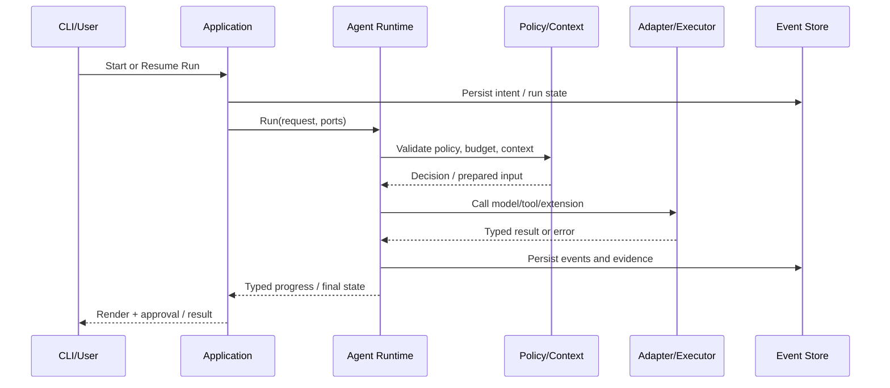

# Deity V0.8 — Developer Experience / TUI 详细设计

> 状态：Proposed；依赖 V0.1/V0.2 基线；不是已实现或已通过验证的功能。

## 1. 版本目标与范围

**目标：**在不改变核心协议的前提下提供可用 TUI 和更顺畅的交互。

**范围控制：**仅引入实现本版本验收所需的依赖和新接口。任何跨层改动必须有 ADR；现有 CLI、FakeModel、基础工具及 SQLite 回归测试必须继续通过。

## 2. 模块与接口设计

### 2.1 统一客户端协议

**实现机制与执行流程**：Application 层公开 `start_run/subscribe_events/approve/cancel/resume`；事件有 seq、run_id、schema_version，可重放快照+增量；CLI 与 TUI 共用服务层。

**接口/数据契约与交付物**：RunHandle、EventSubscription、ApprovalRequest。

**必须覆盖的失败与边界场景**：订阅断开、慢消费者、事件乱序。

**建议实现步骤**：

1. 在 `core/contracts` 定义与具体 SDK 无关的数据类型、错误码、状态及事件 schema。
2. 在 `core`/`application` 实现策略与协调逻辑，适配器负责外部 I/O。
3. 增加 Fake 适配器的确定性单测，覆盖成功、拒绝、异常、取消、重复调用。
4. 接入真实后端并写集成 fixture；在 CLI 提供最小可用入口。
5. 输出审计事件、验证证据、基准结果和回退说明。

### 2.2 Textual TUI

**实现机制与执行流程**：模型流式文本、工具调用树、Diff、验证证据、审批弹窗、模型选择、会话历史；视图状态独立于 Run 状态；键盘操作可访问。

**接口/数据契约与交付物**：TuiApp、RunViewModel、ApprovalDialog；Textual 为可选 extra。

**必须覆盖的失败与边界场景**：终端尺寸变化、Unicode、低带宽终端、渲染背压。

**建议实现步骤**：

1. 在 `core/contracts` 定义与具体 SDK 无关的数据类型、错误码、状态及事件 schema。
2. 在 `core`/`application` 实现策略与协调逻辑，适配器负责外部 I/O。
3. 增加 Fake 适配器的确定性单测，覆盖成功、拒绝、异常、取消、重复调用。
4. 接入真实后端并写集成 fixture；在 CLI 提供最小可用入口。
5. 输出审计事件、验证证据、基准结果和回退说明。

### 2.3 配置与可诊断性

**实现机制与执行流程**：配置优先级 CLI > project > user > default；敏感凭据不写明文日志；`deity doctor` 检查 SDK、rg、git、sqlite、模型凭据与可选 Docker。

**接口/数据契约与交付物**：ConfigResolver、DoctorReport、Redactor。

**必须覆盖的失败与边界场景**：配置冲突、错误提示泄露密钥、平台差异。

**建议实现步骤**：

1. 在 `core/contracts` 定义与具体 SDK 无关的数据类型、错误码、状态及事件 schema。
2. 在 `core`/`application` 实现策略与协调逻辑，适配器负责外部 I/O。
3. 增加 Fake 适配器的确定性单测，覆盖成功、拒绝、异常、取消、重复调用。
4. 接入真实后端并写集成 fixture；在 CLI 提供最小可用入口。
5. 输出审计事件、验证证据、基准结果和回退说明。

### 2.4 交互回归

**实现机制与执行流程**：基于事件录制测试渲染；断线后恢复 UI 不重复提交审批；纯 CLI 保持轻依赖。

**接口/数据契约与交付物**：TUI snapshot/e2e tests。

**必须覆盖的失败与边界场景**：重复审批、界面卡顿、终端兼容性。

**建议实现步骤**：

1. 在 `core/contracts` 定义与具体 SDK 无关的数据类型、错误码、状态及事件 schema。
2. 在 `core`/`application` 实现策略与协调逻辑，适配器负责外部 I/O。
3. 增加 Fake 适配器的确定性单测，覆盖成功、拒绝、异常、取消、重复调用。
4. 接入真实后端并写集成 fixture；在 CLI 提供最小可用入口。
5. 输出审计事件、验证证据、基准结果和回退说明。

## 3. 执行时序（实现基线）

**故障规则**：外部副作用执行前记录 intent；结果未知时保留 `unknown` 并要求协调，不得因网络或进程重启而盲目重放。取消、超时、审批拒绝均产生可追踪终态或等待态。

## 4. 开发拆分与顺序

| 迭代 | 工作项 | 产出 | 依赖 |
|---|---|---|---|
| S1 | 统一客户端协议：契约→Fake 测试→适配器→CLI | 接口、实现、测试、示例 | S0 / V0.2 ports |
| S2 | Textual TUI：契约→Fake 测试→适配器→CLI | 接口、实现、测试、示例 | S1 / V0.2 ports |
| S3 | 配置与可诊断性：契约→Fake 测试→适配器→CLI | 接口、实现、测试、示例 | S2 / V0.2 ports |
| S4 | 交互回归：契约→Fake 测试→适配器→CLI | 接口、实现、测试、示例 | S3 / V0.2 ports |

## 5. 验收标准（可执行）

- [ ] 同一 Run 在 CLI/TUI 呈现一致状态与证据
- [ ] TUI 中取消、审批、恢复完整闭环
- [ ] 未安装 Textual 时 CLI 正常使用
- [ ] 事件重连不丢失/重复执行工具

## 6. 指标与观测

记录 `run_id`、`step_id`、`event_seq`、版本、模型、配置哈希、耗时、工具调用、失败类别、预算、真实验证证据。默认比较基线：V0.1/V0.2 既有 fixture；新能力不得使安全测试回退。阈值需在真实基线测量后固化到 CI。

## 7. 回退与兼容

新能力默认受配置开关控制；关闭后旧流程仍可运行。数据库变更必须提供 forward migration 与可执行的备份/恢复流程；事件 schema 版本化，旧事件只读兼容。发生严重权限或重复副作用缺陷时立即禁用相关功能并阻断发布。

## 8. 明确不做

不引入 LangChain/LangGraph/Deep Agents Runtime；不提前实现后续版本的 UI/分布式组件；不使用模型自评替代测试；不把本地工作区约束描述为沙箱。

## 统一工程约束（所有版本强制执行）

1. **边界不变**：`interfaces → application → core ports ← adapters`；Core 不依赖 CLI、FastAPI、厂商 SDK、SQLite、MCP SDK、Docker SDK。新功能通过 Protocol 注入；禁止跨层快捷调用。
2. **最小依赖**：只在功能实现的那个版本引入实际需要的依赖。新依赖必须记录用途、许可证、维护状态、替代方案、版本锁定、移除成本和安全风险；优先复用 Python 标准库与已存在组件。严禁为了未来可能的功能提前安装完整技术栈。
3. **安全前置**：任何新工具/协议/执行环境必须复用 `schema → policy → boundary → approval → execute → audit`；不把提示词、Skill、AGENTS.md 或 MCP 返回值当作授权依据。Shell 的工作目录限制不是隔离。
4. **验证前置**：每个功能同步交付确定性单元测试、故障注入、集成测试、评估 fixture、事件证据。不能把基准测试、取消、权限、事件审计拖到 V0.9 才做；V0.9 只是平台化。
5. **演进纪律**：数据库/事件/配置格式必须标注版本，提供迁移或向后兼容策略；破坏性修改先写 ADR。所有阶段都有开关和可回退方案。
6. **状态真实性**：模型的文字不能替代工具执行证据。恢复时对结果未知的副作用标记 `unknown`，不得自动重放。
7. **质量门禁**：`ruff check .`、`ruff format --check .`、`mypy src`、`pytest`，以及该版本新增的集成/安全/评估门禁；如未运行，报告必须明确标记。

## 版本交付模板

每一版本必须提供：设计 ADR、接口与数据模型变更、可运行演示、正常/失败/取消测试、指标报告、回滚操作、文档更新。指标阈值是**建议的初始验收目标**，应在首轮基线测量后经 ADR 校准，不得伪称已经达标。
